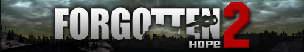

  

# Forgotten Hope 2 community add-ons

A central home for [Battlefield 2](https://en.wikipedia.org/wiki/Battlefield_2) and [Forgotten Hope 2](https://forgottenhope.warumdarum.de/) modding tutorials, guides and tooling.

Many tools and guides for Battlefield 2 modding were written over the last two decades and scattered across forums, personal sites and abandoned repositories. This organization collects them in one place. It hosts new community projects and preserved copies of older ones, so the knowledge stays available to anyone making levels, assets or add-ons for these games.

## Modding tools

| Repository | Description |
| --- | --- |
| [fh2-mod-toolkit](https://github.com/Forgotten-Hope-2-community-addons/fh2-mod-toolkit) | Cross-platform desktop app to export level heightmaps, colormaps and detailmaps to PNG and import them back into the editor formats. |
| [fh2-loadmaps](https://github.com/Forgotten-Hope-2-community-addons/fh2-loadmaps) | Collects the loading-screen image of every level in a mod into a single folder. |
| [fh2-cmp-compatibility-tool](https://github.com/Forgotten-Hope-2-community-addons/fh2-cmp-compatibility-tool) | Checks minimod compatibility between Forgotten Hope 2 object sets. |
| [fh2-map-builder](https://github.com/Forgotten-Hope-2-community-addons/fh2-map-builder) | Docker image to package Forgotten Hope 2 maps. |
| [bf2-blender](https://github.com/Forgotten-Hope-2-community-addons/bf2-blender) | Blender add-on for importing and exporting Battlefield 2 assets. |
| [BfMeshView](https://github.com/Forgotten-Hope-2-community-addons/BfMeshView) | Battlefield 2 model viewer. |
| [BF2Editor](https://github.com/Forgotten-Hope-2-community-addons/BF2Editor) | A simple Battlefield 2 script editor. |
| [bf2-mirror-map](https://github.com/Forgotten-Hope-2-community-addons/bf2-mirror-map) | Mirrors the objects inside a `.con` file. |
| [bf2-infomap-generator](https://github.com/Forgotten-Hope-2-community-addons/bf2-infomap-generator) | Generates vanilla Battlefield 2 style info images for custom levels. |

## Guides and reference material

| Repository | Description |
| --- | --- |
| [bf2-modding-guides](https://github.com/Forgotten-Hope-2-community-addons/bf2-modding-guides) | A large collection of Battlefield 2 and Forgotten Hope 2 modding knowledge gathered over the years. |
| [ww2-aerial-photos-map](https://github.com/Forgotten-Hope-2-community-addons/ww2-aerial-photos-map) | Map of digitized German WWII aerial photographs available at NARA, useful as reference for historical level design. |

## Engine, servers and infrastructure

| Repository | Description |
| --- | --- |
| [fh2-OpenBF2](https://github.com/Forgotten-Hope-2-community-addons/fh2-OpenBF2) | Reconstruction of the Battlefield 2 engine, aiming at a modern client, a secure dedicated server and a proper editor. |
| [bf2-docker](https://github.com/Forgotten-Hope-2-community-addons/bf2-docker) | Battlefield 2 server in a Docker container. |
| [bf2statistics](https://github.com/Forgotten-Hope-2-community-addons/bf2statistics) | Player statistics system for Battlefield 2 servers. |
| [fh2-servers-discord-bot](https://github.com/Forgotten-Hope-2-community-addons/fh2-servers-discord-bot) | Discord bot that shows information about online Forgotten Hope 2 servers. |
| [FH2Installer](https://github.com/Forgotten-Hope-2-community-addons/FH2Installer) | Forgotten Hope 2 installer. |

## Texture packs and visuals

| Repository | Description |
| --- | --- |
| [fh2-matt-bakers-texture-pack](https://github.com/Forgotten-Hope-2-community-addons/fh2-matt-bakers-texture-pack) | Unit-specific, more historically accurate vehicle textures by Matt Baker. |
| [fh2-uncensored-texture-pack](https://github.com/Forgotten-Hope-2-community-addons/fh2-uncensored-texture-pack) | Replaces censored in-game textures with historically accurate versions. |
| [fh2-reshade-presets](https://github.com/Forgotten-Hope-2-community-addons/fh2-reshade-presets) | ReShade presets for Forgotten Hope 2. |

## Preserved projects

Several repositories here are forks of community projects, kept so they remain available if the original goes offline. All credit belongs to their original authors, and each repository keeps its original license and history. If you are the author of one of these projects and want it credited differently or removed, please open an issue in that repository.

## Useful links

* [Forgotten Hope 2 website](https://forgottenhope.warumdarum.de/)
* [Forgotten Hope 2 mapping tutorials](https://forgottenhope.warumdarum.de/tutorials/): setting up the BF2 editor, texturing, heightmaps, lightmapping and 3D modelling.

## Contributing

Contributions are welcome: new tools, fixes, guides, or old projects worth preserving. Open an issue or a pull request in the relevant repository.
